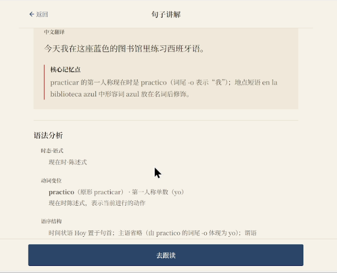
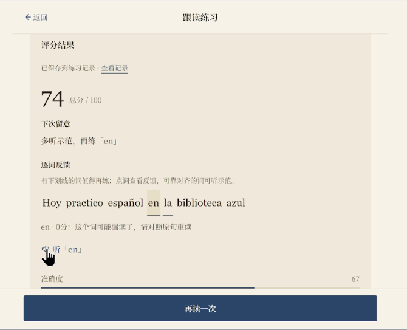
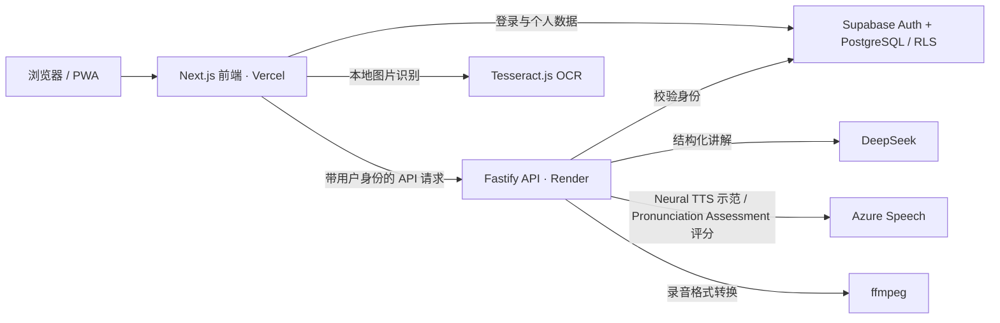

# 跌宕起伏的西语 · Onda Español

**从自己遇到的一句西语开始，理解它、听懂它、读好它，再回来练习。**

[在线体验](https://onda-espanol.vercel.app/) · [产品与设计文档](docs/01-PRD.md) · [阶段验收与发布记录](docs/07-DEVELOPMENT-AND-VALIDATION.md)

这是一个面向个人和少量朋友的西班牙语学习 Web/PWA。它不提供预置课程，而是让学习者带着真实遇到的句子进入一条连续的学习路径：选句 → 中文讲解 → 西语示范 → 真人跟读 → 发音反馈 → 保存与复练。在线体验需要注册并确认邮箱；公开访问不会提供免登录的付费 AI 试用入口。

## 为什么做

我在学习西语时发现：认识一句话里的单词，不代表听得懂整句；逐词读得出来，也不代表重音、连读和语调自然。只给一个发音分数，很难知道下一遍具体该改什么。因此产品把学习单位收缩到**一句用户自己想学的话**，让讲解、听读和反馈服务于同一次练习，而不是分散成互不相关的工具。

## 一句话的学习流程

1. **选句**：输入或粘贴西语；也可以用浏览器内 OCR 从图片提取文字，再人工确认。
2. **理解**：DeepSeek 返回结构化中文翻译、语法分析与发音提示；成功讲解的句子收录到当前用户的个人句子库。
3. **听与读**：Azure Neural TTS 提供整句及薄弱词的西语示范；用户录制自己的朗读，由 Azure Pronunciation Assessment 返回整体、分项和逐词反馈。
4. **针对性复练**：记录页保留评分和近期变化；从反馈中选择下一遍的练习目标，返回同一句继续跟读。
5. **听熟**：从个人句子中选择范围，主动开始连续播放，也可暂停整组、单句精听。

下面两张图取自已上线产品的真实操作录屏；句子和评分是一次演示记录，并非预设的学习成效或代表性测评结果。

在线体验：注册、确认邮箱并登录后，从选句开始，依次体验 AI 中文讲解、语音示范和跟读反馈。

| 中文讲解 | 发音反馈 |
| --- | --- |
|  |  |

### 设计思路与关键取舍

- **先讲透一句，再进入跟读**：把语法、译文和听读提示放在同一学习任务里，降低在多个工具之间切换的成本。
- **逐词反馈比单一总分更可行动**：分数提示整体表现，词级反馈和薄弱词示范帮助决定下一遍听什么、重读什么。评分是辅助信息，不等同于教师判断。
- **记录服务于下一次练习**：历史页提供复练入口；个人句子也可进入听熟列表。句子库与评分记录彼此独立，移出句子不会抹去已有练习历史。
- **把成本边界留在服务端**：讲解、TTS、评分均经登录鉴权和请求限制；浏览器只持有 Supabase 可公开使用的 publishable key，不暴露 AI 服务密钥。

## 实现方式



前端使用 Next.js、React、TypeScript 和 Tailwind CSS；后端使用 Fastify。Azure Neural TTS 负责西语示范，Pronunciation Assessment 负责朗读评分；浏览器录音经后端 ffmpeg 转码后送往评估接口。应用保存评估结果和学习记录，不把录音作为长期学习数据保存。个人句子、练习记录和设置保存在 Supabase，按用户身份及 RLS 隔离。OCR 在浏览器中运行，所选图片无需上传到第三方识别服务。后端对 DeepSeek 的结构化讲解做字段校验，并为请求失败保留可重试的页面状态。

## 当前状态与边界

Stage 4 核心流程已开发、验证并发布到 Production；六份数据库迁移已完成。发布时通过了真实讲解、TTS 请求、真人录音评分、保存/读取及双账号数据隔离的最小冒烟验证，详见[阶段验收与发布记录的 7.6 节](docs/07-DEVELOPMENT-AND-VALIDATION.md)。后续查询体验优化也已部署。项目仍处于个人使用与少量朋友试用阶段，没有可宣称的学习效果、留存或规模化运营数据。

AI 讲解可能出错，发音评分受录音环境影响；离线状态无法完成在线 AI 请求。Render Free 实例休眠时，首次请求可能较慢。iPhone Safari 已验证核心学习路径和添加到主屏后的独立启动；相机/相册 OCR 与多句精听切换等边界尚无真机验证。

## 本地运行

本地建议使用 **Node.js 24**（与后端 Docker 镜像和当前验证环境一致）、npm、ffmpeg，以及你自己的 Supabase、DeepSeek 和 Azure Speech 配置。正式项目的密钥不在仓库中；运行真实 AI 路径会调用外部服务并可能产生费用。

```bash
npm ci
```

分别以 [`web/.env.example`](web/.env.example) 和 [`api/.env.example`](api/.env.example) 为模板，创建不入库的 `web/.env.local`、`api/.env.local`：

- 前端：`NEXT_PUBLIC_SUPABASE_URL`、`NEXT_PUBLIC_SUPABASE_PUBLISHABLE_KEY`、`NEXT_PUBLIC_API_BASE_URL`（本地 API 通常为 `http://localhost:3001`）。
- 后端：`SUPABASE_URL`、`SUPABASE_PUBLISHABLE_KEY`、`DEEPSEEK_API_KEY`、`AZURE_SPEECH_KEY`、`AZURE_SPEECH_REGION`、`FRONTEND_ORIGIN`。本地默认端口是 `3001`，`FRONTEND_ORIGIN` 可设为 `http://localhost:3000`；ffmpeg 不在 PATH 时可设置 `FFMPEG_PATH`。

在**自己的隔离 Supabase 项目**按版本顺序准备 [`supabase/migrations/`](supabase/migrations/) 中的表、函数与 RLS，并配置邮箱登录。随后分别启动两个终端：

```bash
npm run dev:api
npm run dev:web
```

访问 `http://localhost:3000`。仓库提供 `npm run typecheck`、`npm run lint`、`npm run build` 和 `npm run test -w api` 等检查；这些检查不能代替真实设备、语音服务和数据库权限验证。

## 文档与后续

[`docs/`](docs/) 保留 PRD、功能规则、交互、视觉、架构、数据库、API 和阶段验收的决策与实现依据。当前更值得推进的是观察朋友真实试用中遇到的理解、录音、费用与数据恢复问题，再决定下一轮改进；不把路线图中的设想写成现有能力。
